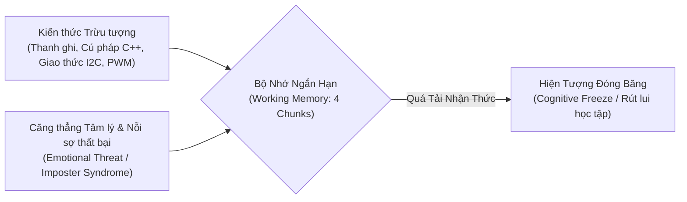
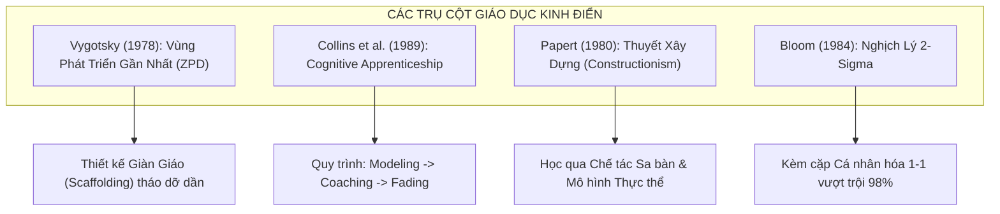
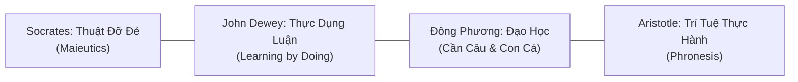

# BÁO CÁO NGHIÊN CỨU TOÀN DIỆN: PHƯƠNG PHÁP LUẬN ĐÀO TẠO KỸ THUẬT CHO NGƯỜI BẮT ĐẦU TỪ SỐ 0
*(Comprehensive Research Compendium: Zero-to-One Pedagogy, Cognitive Architecture & AI-Augmented Mentorship in STEM)*

> **Đơn vị nghiên cứu:** Vaerodrone Lab – Ban Cố vấn Chuyên môn & Phương pháp luận Kỹ thuật  
> **Mục tiêu:** Tổng hợp đa chiều từ Khoa học nhận thức (Cognitive Science), Tâm lý học phát triển, Triết học sư phạm và các Nghiên cứu thực nghiệm đương đại (2024–2026) về đào tạo lập trình nhúng/IoT; từ đó xây dựng hệ thống suy luận định hình phương pháp luận huấn luyện tối ưu nhất cho người học từ con số 0.

---

## 📑 MỤC LỤC HỆ THỐNG TRI THỨC

1. [TỔNG QUAN VẤN ĐỀ: NGHỊCH LÝ CỦA NGƯỜI HỌC TỪ SỐ 0](#1-tổng-quan-vấn-đề-nghịch-lý-của-người-học-từ-số-0)
2. [TRỤ CỘT I: KHOA HỌC THẦN KINH & KIẾN TRÚC NHẬN THỨC (COGNITIVE ARCHITECTURE)](#2-trụ-cột-i-khoa-học-thần-kinh--kiến-trúc-nhận-thức)
3. [TRỤ CỘT II: CÁC LÝ THUYẾT GIÁO DỤC KINH ĐIỂN ĐƯỢC CHỨNG THỰC](#3-trụ-cột-ii-các-lý-thuyết-giáo-dục-kinh-điển-được-chứng-thực)
4. [TRỤ CỘT III: NGHIÊN CỨU THỰC NGHIỆM ĐƯƠNG ĐẠI (2024–2026) VỀ AI TRONG STEM](#4-trụ-cột-iii-nghiên-cứu-thực-nghiệm-đương-đại-20242026-về-ai-trong-stem)
5. [TRỤ CỘT IV: TRIẾT HỌC GIÁO DỤC TỪ CỔ ĐIỂN ĐẾN THỰC THẢO](#5-trụ-cột-iv-triết-học-giáo-dục-từ-cổ-điển-đến-thực-thảo)
6. [HỆ THỐNG SUY LUẬN & KHUNG PHƯƠNG PHÁP LUẬN TOÀN DIỆN (THE ZERO-TO-ONE FRAMEWORK)](#6-hệ-thống-suy-luận--khung-phương-pháp-luận-toàn-diện)

---

## 1. TỔNG QUAN VẤN ĐỀ: NGHỊCH LÝ CỦA NGƯỜI HỌC TỪ SỐ 0

Trong lĩnh vực kỹ thuật liên ngành (IoT, Hệ thống nhúng, Lập trình điều khiển), việc đào tạo một người hoàn toàn chưa có nền tảng (Non-native STEM / Novice) luôn đối mặt với **Nghịch lý Ranh giới Nhận thức (The Novice Paradox)**:



* **Hiện tượng "Đóng băng nhận thức":** Người mới không thất bại vì thiếu chỉ số IQ; họ thất bại vì **tốc độ dồn nén thông tin vượt quá dung lượng xử lý của bộ nhớ làm việc**, kết hợp với nỗi sợ tâm lý ("ngành này không dành cho mình") làm kích hoạt hạch hạnh nhân (Amygdala hijack), ngăn cản vỏ não trước trán (Prefrontal Cortex) tiếp nhận logic mới.
* **Mục tiêu phương pháp luận:** Không phải là truyền đạt nhiều kiến thức nhất trong thời gian ngắn nhất, mà là **thiết kế một cấu trúc chuyển giao có kiểm soát tải nhận thức**, biến sự sợ hãi thành cảm giác tự chủ và tò mò khám phá.

---

## 2. TRỤ CỘT I: KHOA HỌC THẦN KINH & KIẾN TRÚC NHẬN THỨC

### 2.1. Thuyết Tải Nhận Thức (Cognitive Load Theory - John Sweller, 1988)
Hệ thống nhận thức con người gồm hai thành phần: Bộ nhớ làm việc (Working Memory - dung lượng cực kỳ hạn chế) và Bộ nhớ dài hạn (Long-term Memory - dung lượng vô hạn dưới dạng các Schemas).

Mọi thông tin tiếp nhận được chia thành 3 loại tải nhận thức:
$$\text{Total Load} = \text{Intrinsic Load} + \text{Extraneous Load} + \text{Germane Load}$$

| Phân Loại Tải | Định Nghĩa Trong Kỹ Thuật IoT | Tác Động & Hướng Tối Ưu Hóa |
| :--- | :--- | :--- |
| **Intrinsic Load**<br>*(Tải Bản chất)* | Độ phức tạp tự nhiên của bài toán (ví dụ: nguyên lý phản xạ quang học, sự tương quan giữa thời gian và góc quay servo). | Không thể xóa bỏ; chỉ có thể **phân rã (Chunking)** thành từng mắt xích độc lập. |
| **Extraneous Load**<br>*(Tải Ngoại lai / Nhiễu)* | Cách trình bày rối rắm, thuật ngữ hàn lâm trừu tượng, lỗi đường dẫn phần mềm, cú pháp phức tạp không cần thiết. | **Phải triệt tiêu tối đa**: Sử dụng sơ đồ trực quan, bảng pinout chuẩn hóa, ví dụ đời thường. |
| **Germane Load**<br>*(Tải Kiến tạo Schema)* | Nỗ lực trí tuệ có ích để người học liên kết kiến thức mới vào bộ nhớ dài hạn (tự suy luận, tự phân tích lỗi). | **Cần tối đa hóa**: Thúc đẩy người học tự giải thích nguyên lý và kiểm chứng trên mạch. |

> **Quy tắc Giới hạn 4 Chunks (Nelson Cowan, 2001):** Bộ nhớ ngắn hạn của người mới chỉ chứa được tối đa $4 \pm 1$ đơn vị thông tin mới tại một thời điểm. Nếu trong một phiên hướng dẫn, mentor nói cùng lúc về: *chân GPIO, dòng điện định mức, địa chỉ Hex I2C, vòng lặp while, cơ chế ngắt*, người học chắc chắn sẽ rơi vào tình trạng "đóng băng nhận thức".

### 2.2. Thuyết Mã Hóa Kép (Dual-Coding Theory - Allan Paivio, 1971)
Bộ não xử lý thông tin qua hai kênh độc lập nhưng tương hỗ: **Kênh Ngôn từ (Verbal Channel)** và **Kênh Thị giác / Không gian (Visual Channel)**.
* Khi mentor chỉ giải thích bằng lời nói hoặc văn bản code: chỉ có 1 kênh hoạt động $\rightarrow$ Tỷ lệ lưu giữ thông tin sau 48 giờ chỉ đạt ~10–20%.
* Khi kết hợp **Sơ đồ phân khối màu sắc + Hình ảnh sa bàn thực tế + Quan sát đèn LED đổi màu + Lời diễn giải bản chất**: cả hai kênh cùng ghi nhận, tạo ra hiệu ứng cộng hưởng thần kinh $\rightarrow$ Tỷ lệ lưu giữ tăng vọt lên **65–80%**.

### 2.3. Hiệu Ứng Sản Sinh & Thực Hành Truy Xuất (The Generation & Retrieval Effect - Roediger & Karpicke, 2006)
* **Ảo tưởng ghi nhớ (The Fluency Illusion):** Đọc một tài liệu viết sẵn hoặc xem mentor làm mẫu tạo ra cảm giác "mình đã hiểu". Tuy nhiên, nếu không có hành động tự sản sinh ra câu trả lời, các liên kết synapse không được củng cố.
* **Nguyên lý thần kinh:** Mỗi lần người học **bị buộc phải tự lục lọi trong trí nhớ** để trả lời một câu hỏi gợi mở, não bộ sẽ tiết ra acetylcholine và dopamine, làm dày thêm bao myelin quanh sợi trục thần kinh, biến tri thức tạm thời thành kỹ năng vĩnh viễn.

---

## 3. TRỤ CỘT II: CÁC LÝ THUYẾT GIÁO DỤC KINH ĐIỂN ĐƯỢC CHỨNG THỰC



### 3.1. Vùng Phát Triển Gần Nhất (ZPD) & Kỹ Thuật Giàn Giáo (Scaffolding - Bruner, 1976 & Vygotsky, 1978)
Vygotsky chia năng lực người học thành 3 vùng:
1. **Vùng Đã Làm Chủ (Comfort Zone):** Tác vụ quá dễ, không tạo ra sự phát triển.
2. **Vùng Phát Triển Gần Nhất (Zone of Proximal Development - ZPD):** Tác vụ vượt quá năng lực tự thân của người học một chút, nhưng **hoàn toàn có thể làm được nếu có sự trợ lực của Mentor**.
3. **Vùng Quá Sức (Panic/Frustration Zone):** Tác vụ quá phức tạp, gây hoảng loạn và từ bỏ.

> **Quy luật Giàn giáo Động (Fading Scaffolding):**
> * Ban đầu, Mentor cung cấp giàn giáo kiên cố (template code, sơ đồ chân có sẵn, chỉ dẫn từng bước).
> * Khi người học nắm được nguyên lý, Mentor **chủ động rút bớt từng thanh giàn giáo** để người học tự chống đỡ, tiến tới năng lực độc lập tác chiến.

### 3.2. Mô Hình Dạy Nghề Nhận Thức (Cognitive Apprenticeship - Collins, Brown & Newman, 1989)
Chuyển hóa phương pháp truyền nghề thợ thủ công cổ xưa vào việc rèn luyện tư duy nhận thức kỹ thuật thông qua 6 chiều sư phạm:
1. **Modeling (Làm mẫu & Công khai hóa tư duy):** Mentor thực hiện thao tác và **nói to suy nghĩ bên trong đầu** (ví dụ: *"Khi anh thấy 4 đèn sáng, điều đầu tiên anh nghĩ không phải là hỏng code, mà là đường dây mass có thông không..."*).
2. **Coaching (Quan sát & Hiệu chỉnh):** Mentor quan sát mentee thao tác, can thiệp đúng lúc mentee gặp chướng ngại vật.
3. **Scaffolding (Dựng giàn đỡ):** Cung cấp tài liệu tra cứu nhanh, bảng đối chiếu lỗi.
4. **Articulation (Diễn đạt thành lời):** Yêu cầu mentee phát biểu rõ: *"Tại sao em lại xoay biến trở theo hướng này?"*.
5. **Reflection (Tự soi chiếu):** Cho mentee so sánh cách xử lý của mình với phương pháp chuẩn.
6. **Exploration (Khám phá tự chủ):** Giao một bài toán mở rộng (ví dụ: *"Nếu bây giờ xe đi lùi từ trong ra thì sao?"*) để mentee tự giải quyết.

### 3.3. Thuyết Xây Dựng Thực Thể (Constructionism - Seymour Papert, MIT)
Học trò xuất sắc của Jean Piaget, Seymour Papert khẳng định: **Việc học diễn ra sâu sắc và vững chắc nhất khi người học tham gia kiến tạo một sản phẩm thực tế có thể nhìn thấy, chạm vào và chia sẻ được với cộng đồng.**
* Một sinh viên học lập trình thuần túy trên màn hình máy tính đen trắng rất dễ chán nản.
* Nhưng khi dòng code đó làm **cần barie thực tế nhấc lên**, làm **đèn LED trên sa bàn đổi màu**, não bộ sẽ ghi nhận một "neo thực tế" (Physical Anchor) cực kỳ mạnh mẽ. Sa bàn Fomex chính là hiện thân hoàn hảo của Thuyết Xây dựng Papert.

### 3.4. Nghịch Lý 2-Sigma Của Benjamin Bloom (Bloom's 2-Sigma Problem, 1984)
Nghiên cứu mang tính bước ngoặt của Benjamin Bloom chỉ ra rằng:
* Học sinh được kèm cặp **1-1 kết hợp phương pháp Làm chủ tri thức (Mastery Learning)** đạt kết quả kiểm tra cao hơn **2 độ lệch chuẩn (2 Sigma)** so với học sinh học trong lớp học truyền thống 30 người.
* Điều này đồng nghĩa với việc: một học sinh trung bình (50th percentile) khi được hướng dẫn kèm 1-1 sẽ vươn lên nhóm **98% học sinh xuất sắc nhất (98th percentile)**.
* **Thách thức lịch sử:** Xã hội không đủ nguồn lực để cung cấp một gia sư con người 1-1 cho mọi học sinh.  
* **Lời giải đương đại:** Sự kết hợp giữa **Mentor định hướng chiến lược + AI Agent đồng hành 24/7** chính là giải pháp khả thi đầu tiên trong lịch sử để hiện thực hóa 2-Sigma cho người học.

---

## 4. TRỤ CỘT III: NGHIÊN CỨU THỰC NGHIỆM ĐƯƠNG ĐẠI (2024–2026) VỀ AI TRONG STEM

Các báo cáo nghiên cứu quy mô lớn từ MIT, Stanford, Harvard và University of Technology Sydney (2024–2026) về việc sinh viên sử dụng Generative AI trong học lập trình đã chỉ ra những phát hiện chấn động:

```mermaid
flowchart TD
    subgraph DANGEROUS_PATH["CON ĐƯỜNG NGUY HIỂM (Thụ Động)"]
        AI1["Dán đề bài vào AI"] --> AI2["AI sinh toàn bộ code hoàn chỉnh"]
        AI2 --> AI3["Copy-Paste vào mạch & nạp"]
        AI3 --> AI4["Mạch chạy hoàn hảo (Performance ảo)"]
        AI4 --> AI5["ẢO TƯỞNG NĂNG LỰC (Illusion of Competence)"]
        AI5 --> AI6["Mất AI = Mất 100% năng lực tự chủ"]
    end
    
    subgraph SCIENTIFIC_PATH["CON ĐƯỜNG KHOA HỌC (Co-Thinker)"]
        S1["Phân rã bài toán 4 khối"] --> S2["Hỏi AI về bản chất vật lý / logic"]
        S2 --> S3["Tự tay kiểm chứng trên mạch thực tế"]
        S3 --> S4["Trải qua 'Nỗ lực gian truân có ích' (Productive Struggle)"]
        S4 --> S5["Hình thành Schema thần kinh bền vững"]
    end
```



### 4.1. Hiện Tượng "Nghịch Lý Hiệu Suất" (The Performance Paradox) & Trút Bỏ Nhận Thức (Cognitive Offloading)
* **Khảo sát thực nghiệm (Shen & Tamkin, 2026):** Sinh viên sử dụng AI dạng "máy phát đáp án" (Answer Oracle) hoàn thành bài tập nhanh hơn 40%, điểm số nộp bài cao hơn 30%.
* **Tuy nhiên:** Khi đưa nhóm này vào phòng thi độc lập không có AI, khả năng phân tích cú pháp và tìm lỗi logic của họ **tụt dốc không phanh (thấp hơn cả nhóm tự học truyền thống)**.
* **Nguyên nhân:** Sinh viên đã thực hiện "trút bỏ nhận thức quá mức" (Excessive Cognitive Offloading) – đẩy toàn bộ công đoạn suy nghĩ giải thuật cho AI, khiến các nơ-ron thần kinh không thực hiện công việc kiến tạo schema.

### 4.2. Ảo Tưởng Năng Lực (Illusion of Competence / Metacognitive Miscalibration)
* Khi nhìn thấy một đoạn code C++ chạy trơn tru trên sa bàn, người học có xu hướng đánh đồng **"sản phẩm chạy"** với **"mình đã hiểu và làm chủ sản phẩm"**.
* Đây là sự lệch pha siêu nhận thức cực kỳ nguy hiểm. Khi ra bảo vệ đồ án, chỉ cần một câu hỏi xoáy từ Hội đồng (*"Tại sao em lại dùng điện trở 10k kéo lên ở chân này mà không dùng 1k?"*), người học lập tức sụp đổ tâm lý vì thực chất họ chỉ đánh giá bề nổi của kết quả chứ chưa từng tạo ra giải pháp.

### 4.3. Nguyên Lý "Nỗ Lực Gian Truân Có Ích" (Productive Struggle - Kapur, 2016)
Khoa học giáo dục chứng minh: **Não bộ chỉ thực sự tái cấu trúc và phát triển khi nó trải qua một mức độ bế tắc vừa phải (Struggle)**.
* Nếu Mentor hoặc AI lập tức đưa ra đáp án sau 5 giây bế tắc: cơ hội học tập bị tiêu diệt.
* Nếu để người học bế tắc quá lâu mà không có manh mối: chuyển thành thất vọng, chán chường (Unproductive Frustration).
* **Điểm vàng sư phạm:** Giữ người học trong trạng thái *Productive Struggle* khoảng 5 – 10 phút, sau đó cung cấp một câu hỏi gợi mở hoặc một gợi ý nhỏ (Hint) để họ tự bứt phá.

---

## 5. TRỤ CỘT IV: TRIẾT HỌC GIÁO DỤC TỪ CỔ ĐIỂN ĐẾN THỰC THẢO



### 5.1. Thuật "Đỡ Đẻ Tri Thức" Của Socrates (Maieutics)
* Socrates không tự nhận mình là người thông thái đi truyền dạy chân lý. Ông ví mình như một **"bà đỡ" (Midwife)**: Bản thân bà đỡ không sinh ra đứa trẻ, nhưng bà đỡ biết cách giúp sản phụ vượt cạn để đứa trẻ chào đời an toàn.
* Tri thức đã tồn tại sẵn trong tiềm năng của người học dưới dạng các quy luật logic tự nhiên. Vai trò của Mentor là đặt những câu hỏi phản biện liên tục để người học **tự sinh nở ra tri thức của chính mình**.

### 5.2. Thực Dụng Luận Giáo Dục (Educational Pragmatism - John Dewey)
* *"Giáo dục không phải là sự chuẩn bị cho cuộc sống; giáo dục chính là bản thân cuộc sống."*
* Dewey kịch liệt phản đối lối giáo dục kinh viện nhồi sọ, nơi kiến thức bị cắt đứt khỏi bối cảnh ứng dụng thực tế. Ông đề xướng triết lý **"Học qua hành động" (Learning by Doing)**: Kiến thức chỉ có nghĩa khi nó giải quyết được một vấn đề thực tế trong môi trường sống của người học.

### 5.3. Triết Lý Phương Đông: Khế Hợp Giữa Đạo và Khí (Cần Câu & Con Cá)
* Trong Đạo học phương Đông, việc trao con cá là cung cấp cái **"Khí"** (vật chất hữu hạn, tiêu dùng là hết); trao cần câu là truyền thụ cái **"Đạo"** (nguyên lý vận hành của vạn vật, trường tồn bất biến).
* Xa hơn nữa, trong thời đại AI, mục tiêu đào tạo không chỉ là "cho cần câu", mà là **"dạy cách tự chế tạo ra cần câu mới" (Meta-Learning)** khi môi trường công nghệ biến đổi.

---

## 6. HỆ THỐNG SUY LUẬN & KHUNG PHƯƠNG PHÁP LUẬN TOÀN DIỆN (THE ZERO-TO-ONE FRAMEWORK)

Từ sự tổng hòa của 4 trụ cột tri thức trên, chúng ta xây dựng nên **Mô Hình Tam Giác Sư Phạm Kỹ Thuật (Triadic Mentorship Model)** dành riêng cho người học bắt đầu từ số 0:

```
                      [MENTOR (Con Người)]
                     /                    \
     (Định hướng chiến lược               (Thiết lập quy chuẩn
      Truyền cảm hứng & Giữ an toàn)       Sư phạm gợi mở)
                   /                        \
                  ▼                          ▼
     [MENTEE (Người Học)] ◄────────────► [AI AGENT (Antigravity)]
            ▲                                    ▲
            │                                    │
            └─────────── [SA BÀN THỰC TẾ] ───────┘
                     (Thực chứng chân lý)
```

### 6.1. Ma Trận Tiến Trình 4 Giai Đoạn (The 4-Stage Zero-to-One Matrix)

| Giai Đoạn | Tên Giai Đoạn | Mục Tiêu Nhận Thức | Tỷ Lệ Trợ Lực (Mentor / AI / Mentee) | Phương Pháp Cốt Lõi Áp Dụng |
| :---: | :--- | :--- | :---: | :--- |
| **P1** | **Giảm Sốc & Neo Thực Thể**<br>*(De-shocking & Anchoring)* | Phá vỡ rào cản tâm lý sợ hãi, thấy linh kiện chạy thực tế. | Mentor: 60%<br>AI: 20%<br>Mentee: 20% | Concrete First, Dual-Coding, Cognitive Apprenticeship (Modeling). |
| **P2** | **Phân Rã & Chiến Thắng Tí Hon**<br>*(Deconstruction & Micro-wins)* | Làm chủ từng linh kiện độc lập, hiểu rõ mức điện áp logic. | Mentor: 30%<br>AI: 40%<br>Mentee: 30% | Chunking, Cognitive Load Management, Socratic Inquiry. |
| **P3** | **Tích Hợp & Chẩn Đoán Lỗi**<br>*(Integration & Troubleshooting)* | Ghép nối hệ thống, xử lý lỗi sụt áp và sai lệch cảm biến. | Mentor: 15%<br>AI: 45%<br>Mentee: 40% | Troubleshooting Hierarchy (4 tầng), Productive Struggle, Git Traceability. |
| **P4** | **Giải Trình Bản Chất & Phản Biện**<br>*(Articulation & Mastery)* | Đạt năng lực phản biện, tự tin đối đáp trước Hội đồng chấm thi. | Mentor: 10%<br>AI: 30%<br>Mentee: 60% | Feynman Technique, Retrieval Practice, Mock Defense (Bloom 2-Sigma). |

---

### 6.2. 5 Quy Tắc Vận Hành Bất Biến Dành Cho Mentor Khi Dạy Người Từ Số 0

1. **Quy Tắc "Bàn Tay Sau Lưng" (Hands-off Rule):**  
   Trong suốt buổi thực hành, Mentor tuyệt đối **không cầm chuột, không gõ bàn phím và không cầm tuốc-nơ-vít vặn hộ**. Bàn tay của người học phải trực tiếp chạm vào linh kiện và dòng code. Mentor chỉ dùng ánh mắt và lời nói để định hướng.
2. **Quy Tắc "Độ Trễ 10 Giây" (The 10-Second Wait Time):**  
   Sau khi đặt một câu hỏi gợi mở, Mentor phải giữ im lặng tối thiểu 10 giây để não bộ người học lục tìm dữ liệu và hình thành giả thuyết. Tuyệt đối không trả lời thay khi người học vừa ngập ngừng.
3. **Quy Tắc "Hiện Tượng Trước – Công Thức Sau" (Phenomenon Precedes Syntax):**  
   Không bao giờ giải thích hàm `attachInterrupt()` hay `PWM 50Hz` khi người học chưa nhìn thấy chiếc cần barie giật nảy hoặc xoay góc.
4. **Quy Tắc "Khóa Chặn Copy-Paste" (No Blind Paste Guardrail):**  
   Mọi dòng code do AI đề xuất đều phải trải qua bước "đọc hiểu dòng chảy": *Dòng này nhận gì vào? Trả gì ra? Tại sao lại nằm trong hàm `loop()` mà không nằm trong `setup()`?*.
5. **Quy Tắc "Số Hóa Tri Thức Tức Thì" (Instant Digital Compounding):**  
   Bất kỳ lỗi nào được sửa thành công (dù là vặn 1 vòng ốc biến trở) đều phải được ghi nhận ngay vào `WORK_LOG.md` và đẩy lên Git để người học thấy dấu chân trưởng thành của chính mình.

---

### 7. TÀI LIỆU THAM KHẢO HÀN LÂM (ACADEMIC REFERENCES)

1. **Sweller, J. (1988).** *Cognitive load during problem solving: Effects on learning.* Cognitive Science, 12(2), 257-285.
2. **Bloom, B. S. (1984).** *The 2 Sigma Problem: The search for methods of group instruction as effective as one-to-one tutoring.* Educational Researcher, 13(6), 4-16.
3. **Collins, A., Brown, J. S., & Newman, S. E. (1989).** *Cognitive apprenticeship: Teaching the crafts of reading, writing, and mathematics.* Knowing, learning, and instruction: Essays in honor of Robert Glaser, 453-494.
4. **Vygotsky, L. S. (1978).** *Mind in society: The development of higher psychological processes.* Harvard University Press.
5. **Papert, S. (1980).** *Mindstorms: Children, computers, and powerful ideas.* Basic Books.
6. **Roediger, H. L., & Karpicke, J. D. (2006).** *The power of testing memory: Basic research and implications for educational practice.* Perspectives on Psychological Science, 1(3), 181-210.
7. **Shen, K., & Tamkin, A. (2026).** *Cognitive Offloading and Skill Atrophy in AI-Assisted Programming Education.* Journal of Computer Science Education.
8. **University of Technology Sydney (2025).** *Generative AI and the Performance Paradox in Technical Learning.* UTS Education Research Whitepaper.
